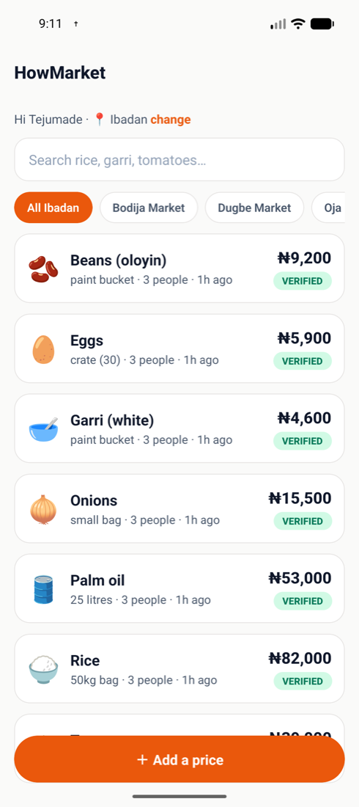
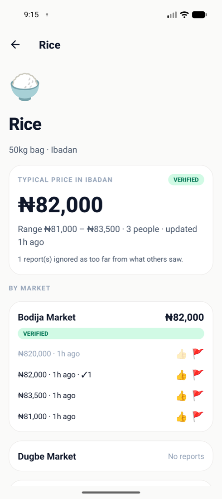
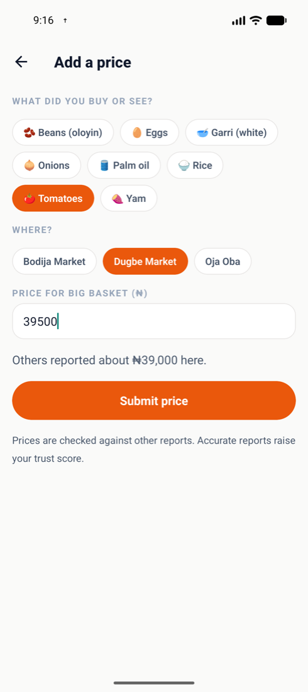
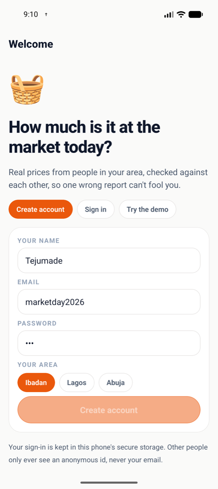
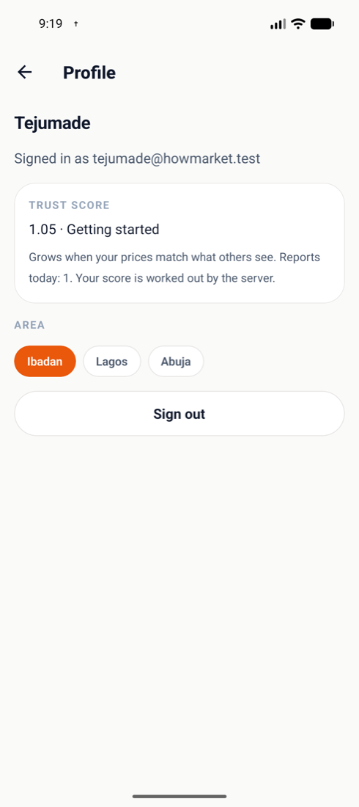

<p align="center">
  
</p>

<h1 align="center">HowMarket</h1>

<p align="center">
  <strong>How much is it at the market today?</strong><br />
  Real food prices from people near you, checked so one bad report can't fool anyone.
</p>

<p align="center">
  
  
  
  
  
</p>

<p align="center">
  
  
  
  
  
</p>

---

## Why HowMarket

Food prices in Nigerian markets change week to week, and the only way to know is to go and ask. HowMarket lets shoppers share what they paid at Bodija, Oja Oba, Mile 12 or Wuse, so anyone can see today's price before leaving home. The hard part is trust, because anyone can type a wrong number. HowMarket is built so that doesn't matter.

## Features

| | |
|---|---|
| **Prices in my area** | Every item's consensus price, per market or across your whole area, with a *Verified*, *Likely* or *Unconfirmed* badge. |
| **Item detail** | The price in each market, the range, and every report behind it. Confirm 👍 a report you agree with or flag 🚩 one that looks wrong. |
| **Add a price** | Report what you saw today. If it's far from what others reported, the app asks you to double-check the amount and unit. |
| **Accounts** | Create an account or sign in with email and password. The sign-in token is kept in the phone's secure storage (Keychain / Keystore). Or try the demo with a local profile and labelled sample prices. |

## How prices stay accurate

No single report sets a price. [`src/lib/consensus.ts`](src/lib/consensus.ts) does this for each item in each market:

1. **Recency.** Only the last 14 days count, and a report's weight halves every 3 days.
2. **Outlier removal.** A robust statistical test (median absolute deviation) plus a hard ½×–2× band drops typos and fake prices.
3. **Weighted median.** What's left is combined by recency × reporter trust × community votes.
4. **Confidence.** *Verified* needs 3+ different people agreeing within 3 days with a tight spread. One person posting many times still counts as one.
5. **Trust scores.** Reporters whose prices match consensus gain trust; repeat outliers lose it (range 0.2–2).
6. **Server rules** ([howmarket-api](https://github.com/tejHacks/howmarket-api)). The Laravel API enforces them and runs the same consensus code:
   - one vote per person, and no voting on your own report;
   - 20 reports a day;
   - sane price bounds;
   - trust scores that only the server can change.

   Other reporters appear only as anonymous ids.

## Tech

- **Expo SDK 58** (React Native 0.88, React 19.3), Expo Router, TypeScript (strict), React Compiler
- **Laravel 13 API** ([howmarket-api](https://github.com/tejHacks/howmarket-api)) with Sanctum tokens for accounts and shared prices
- **expo-secure-store** for the token; **AsyncStorage** for demo mode and the offline price cache
- **Jest** + React Native Testing Library

```
src/
  app/          screens (Expo Router): prices, item/[id], add, login, profile
  components/   UI primitives and the confidence badge
  data/         store.ts (one hook, demo or live account) and seed data
  lib/          consensus.ts, api.ts (API client), token.ts (secure storage), storage
plugins/        with-local-api.js: plain http only to the local dev server, HTTPS everywhere else
__tests__/      consensus rules and app flows
```

## Getting started

```bash
npm install
npx expo start          # press i for iOS, a for Android, w for web
```

Pick **Try the demo** on the sign-in screen for sample prices in Ibadan, Lagos and Abuja.

### Using the real backend

1. Run [howmarket-api](https://github.com/tejHacks/howmarket-api) with `php artisan serve --host 0.0.0.0 --port 8001`.
2. The app finds it at `http://10.0.2.2:8001/api` from the Android emulator and at `http://127.0.0.1:8001/api` from the iOS simulator.
3. For a deployed server, set `EXPO_PUBLIC_API_URL=https://…/api`, or change it under **Server settings** on the sign-in screen.

Release builds allow plain http only to those local addresses; anything else must be HTTPS.

### Tests

```bash
npm test                # 20 tests
npx tsc --noEmit        # typecheck
npx expo lint           # lint
```

The tests cover the consensus rules (a typo can't move the price, one person can't fake agreement, stale reports lower confidence, trust rises and falls within its limits, the daily report limit), the API client (tokens, errors, server address checks), the demo flow, and a live sign-up that keeps the token out of AsyncStorage.

## Roadmap

- [ ] Photo of the price tag on each report
- [ ] Location check that you're near the market when you report
- [ ] Trusted market "verifiers"
- [ ] Price-history charts and price-drop alerts
- [ ] More cities and markets

## Author

Built by **Olateju Olamide Emmanuel**, mobile developer & ML engineer.
[Portfolio](https://tejusportfolio.vercel.app) · [GitHub](https://github.com/tejHacks) · [LinkedIn](https://www.linkedin.com/in/olateju-olamide-22314a292/)

## License

MIT, see [LICENSE](LICENSE).
